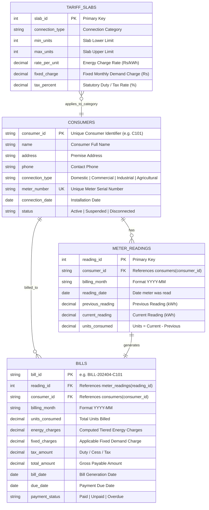

# Electricity Consumption Management and Energy Usage Analysis System
**Scenario 14 | Register Number: 732925ITR104**  
*Technology Stack: Java (Core/JDBC), DBMS (MySQL/SQLite), Python (Pandas/Matplotlib/Seaborn)*

---

## 1. Problem Statement
An electricity distribution office maintains consumer details, meter readings, monthly electricity consumption, and billing records. Managing these records manually can make it difficult to calculate electricity bills accurately, identify high-consumption consumers, and analyze changes in energy usage over time.

This project delivers an integrated **Electricity Consumption Management and Energy Usage Analysis System** designed to:
- Maintain consumer master records and meter specifications.
- Record monthly previous and current meter readings with auto-consumption computation.
- Compute electricity bills via tiered tariff slabs, fixed charges, and taxes.
- Generate consumer invoices, monthly audit reports, and high-consumption alert lists.
- Extract consumption metrics from the database, preprocess them, and generate visual analytics using Python.

---

## 2. Functional Requirements Coverage

| Req # | Functional Requirement | Implementation Component |
| :---: | :--- | :--- |
| **1** | Maintain consumer details (ID, name, address, connection type) | `consumers` table, `Consumer.java`, `ConsumerDAO.java`, Main Menu Option 1 & 2 |
| **2** | Record previous and current meter readings for each billing period | `meter_readings` table, `MeterReading.java`, `MeterReadingDAO.java`, Menu Option 3 |
| **3** | Calculate electricity consumption (`units = current - previous`) | `MeterReading.calculateUnitsConsumed()`, SQL validation check, Menu Option 3 |
| **4** | Calculate electricity bills using predefined tariff rates & charges | `tariff_slabs` table, `BillingService.java`, progressive tiered slabs, Menu Option 4 |
| **5.1** | Generate consumer-wise bills (detailed invoice) | `Bill.java`, `ReportService.printConsumerBill()`, Menu Option 5 |
| **5.2** | Generate monthly consumption reports | `ReportService.printMonthlyConsumptionReport()`, SQL query, Menu Option 6 |
| **5.3** | Lists of high-consumption consumers (with severity alerts) | `ReportService.printHighConsumptionReport()`, SQL query, Menu Option 7 |
| **6** | Retrieve DB data, preprocess & generate Python visualizations | `energy_analysis.py`, SQLite/CSV pipeline, Pandas, Matplotlib, SVG dashboard |

---

## 3. System Architecture & ER Diagram

### System Architecture Flow

```
+-----------------------------------------------------------------------------------+
|                            JAVA MANAGEMENT APPLICATION                            |
|  - Consumer Registration  - Meter Reading (Current - Prev)  - Tiered Bill Calc    |
|  - Consumer Invoices      - Monthly Audits                  - High-Usage Alerts   |
+-----------------------------------------+-----------------------------------------+
                                          |
                                    JDBC Connection
                                          |
                                          v
+-----------------------------------------------------------------------------------+
|                        DBMS LAYER (MySQL / SQLite Database)                       |
|  - consumers             - tariff_slabs           - meter_readings     - bills    |
+-----------------------------------------+-----------------------------------------+
                                          |
                                Data Extraction Pipeline
                                          |
                                          v
+-----------------------------------------------------------------------------------+
|                       PYTHON DATA PREPROCESSING & VISUALIZATION                   |
|  - Pandas & NumPy Cleaning  - MoM Growth Trends   - Outlier Detection             |
|  - Sector Share Donut Plot  - Monthly Trendlines  - Interactive Web Dashboard     |
+-----------------------------------------------------------------------------------+
```

### Entity-Relationship (ER) Diagram



---

## 4. Predefined Tariff Slab Structure

The billing engine applies progressive (tiered) slabs based on the consumer's connection type:

### 🏠 Domestic
- **0 – 100 units**: Rs. 3.50 / unit | Fixed Charge: Rs. 50.00 | Tax: 5%
- **101 – 300 units**: Rs. 5.20 / unit | Fixed Charge: Rs. 75.00 | Tax: 5%
- **301 – 500 units**: Rs. 7.50 / unit | Fixed Charge: Rs. 100.00 | Tax: 5%
- **Above 500 units**: Rs. 9.80 / unit | Fixed Charge: Rs. 150.00 | Tax: 5%

### 🏢 Commercial
- **0 – 200 units**: Rs. 8.50 / unit | Fixed Charge: Rs. 200.00 | Tax: 9%
- **201 – 750 units**: Rs. 11.00 / unit | Fixed Charge: Rs. 350.00 | Tax: 9%
- **Above 750 units**: Rs. 13.50 / unit | Fixed Charge: Rs. 500.00 | Tax: 9%

### 🏭 Industrial
- **0 – 1000 units**: Rs. 9.00 / unit | Fixed Charge: Rs. 800.00 | Tax: 12%
- **Above 1000 units**: Rs. 12.50 / unit | Fixed Charge: Rs. 1500.00 | Tax: 12%

### 🌾 Agricultural
- **0 – 500 units**: Rs. 1.50 / unit (subsidized) | Fixed Charge: Rs. 30.00 | Tax: 2%
- **Above 500 units**: Rs. 2.80 / unit | Fixed Charge: Rs. 50.00 | Tax: 2%

---

## 5. Directory Structure

```
electricity-consumption-system/
│
├── index.html                  # Live interactive web dashboard portal
├── README.md                   # Complete documentation, ER diagrams & viva guide
│
├── database/
│   ├── schema.sql              # Relational schema (DDL) for SQLite & MySQL
│   ├── sample_data.sql         # 48+ realistic historical records & consumers (DML)
│   ├── queries.sql             # Analytical queries (high consumers, aggregates)
│   ├── electricity.db          # Pre-built SQLite database file
│   ├── energy_data.csv         # Exported CSV analytical dataset
│   └── init_database.py        # Automated DB generator script
│
├── java_app/
│   ├── compile_and_run.bat     # Windows batch launcher
│   ├── run.sh                  # Linux / macOS bash launcher
│   └── src/com/electricity/
│       ├── Main.java           # Interactive CLI management console
│       ├── model/
│       │   ├── Consumer.java
│       │   ├── MeterReading.java
│       │   ├── TariffSlab.java
│       │   └── Bill.java
│       ├── dao/
│       │   ├── DBConnection.java
│       │   ├── ConsumerDAO.java
│       │   ├── MeterReadingDAO.java
│       │   └── BillDAO.java
│       └── service/
│           ├── BillingService.java
│           └── ReportService.java
│
└── python_analysis/
    ├── energy_analysis.py      # Data retrieval, preprocessing & visualizer
    ├── requirements.txt        # pandas, numpy, matplotlib, seaborn
    └── output/
        ├── 1_monthly_consumption_trend.png
        ├── 2_consumption_by_connection_type.png
        ├── 3_high_consumption_consumers.png
        └── energy_usage_dashboard.html # Standalone HTML dashboard
```

---

