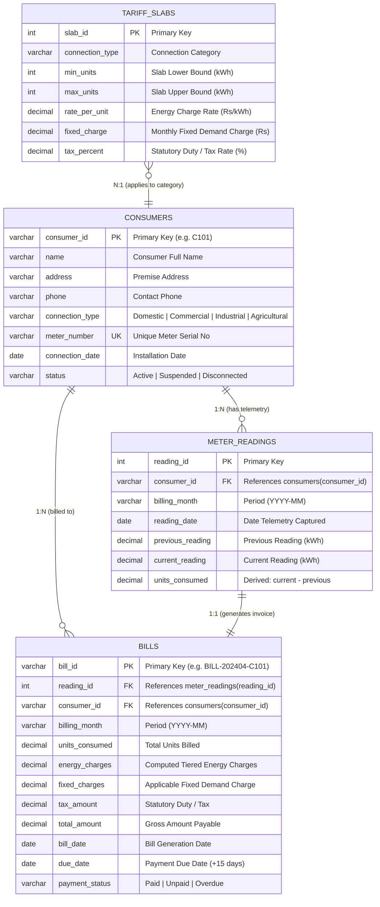

# Part 1: DBMS Module Presentation & Evaluation Guide
**Scenario 14: Electricity Consumption Management and Energy Usage Analysis System**  
**Student Register Number:** 732925ITR104  
**Database Technology:** MySQL (Enterprise RDBMS) / SQLite (Embedded Datastore)  

---

## 1. Objective of the DBMS Module
To design, normalize, and implement a robust relational database schema that maintains:
1. Consumer master details with categorical connection types (`Domestic`, `Commercial`, `Industrial`, `Agricultural`).
2. Monthly meter readings with strict integrity constraints (`current_reading >= previous_reading`).
3. Tiered tariff rate slabs and statutory taxation rates.
4. Billed consumption records, charge breakdowns, and payment statuses.

---

## 2. Entity-Relationship (ER) Diagram

### 2.1 Visual ER Diagram (Crow's Foot Notation)



---

### 2.2 Structural Cardinality & Relationship Breakdown

| Entity 1 | Relationship | Entity 2 | Cardinality Ratio | Participation Constraint | Business Rule & Description |
| :--- | :---: | :--- | :---: | :---: | :--- |
| **`CONSUMERS`** | *has / logs* | **`METER_READINGS`** | **1 : N** (One-to-Many) | Mandatory (1) to Optional (N) | One consumer can have multiple monthly meter readings over time; each reading belongs to exactly one consumer. |
| **`METER_READINGS`** | *generates* | **`BILLS`** | **1 : 1** (One-to-One) | Mandatory (1) to Optional (1) | Each monthly meter reading produces exactly one bill record. |
| **`CONSUMERS`** | *billed to* | **`BILLS`** | **1 : N** (One-to-Many) | Mandatory (1) to Optional (N) | One consumer accumulates multiple billing cycle invoices. |
| **`TARIFF_SLABS`** | *applies to* | **`CONSUMERS`** | **N : 1** (Many-to-One) | Mandatory (N) to Mandatory (1) | Progressive tariff slab bands apply based on the consumer's connection type. |

---

### 2.3 Attributes Classification (For Viva)

* **Key Attributes (Primary Keys):**
  * `consumers.consumer_id`
  * `meter_readings.reading_id`
  * `bills.bill_id`
  * `tariff_slabs.slab_id`
* **Candidate / Unique Keys:**
  * `consumers.meter_number` (Enforces unique physical meter per connection).
* **Foreign Keys (Referential Integrity):**
  * `meter_readings.consumer_id` $\rightarrow$ `consumers.consumer_id` (`ON DELETE CASCADE`)
  * `bills.consumer_id` $\rightarrow$ `consumers.consumer_id` (`ON DELETE CASCADE`)
  * `bills.reading_id` $\rightarrow$ `meter_readings.reading_id` (`ON DELETE CASCADE`)
* **Derived Attribute:**
  * `meter_readings.units_consumed` is derived from:
    $$\text{units\_consumed} = \text{current\_reading} - \text{previous\_reading}$$
* **Domain Check Constraints:**
  * `CHECK (connection_type IN ('Domestic', 'Commercial', 'Industrial', 'Agricultural'))`
  * `CHECK (current_reading >= previous_reading)`
  * `CHECK (status IN ('Active', 'Suspended', 'Disconnected'))`
  * `CHECK (payment_status IN ('Unpaid', 'Paid', 'Overdue'))`

---

## 3. Relational Schema & Table Structures (DDL)

```sql
-- 1. Consumers Table (Master Table)
CREATE TABLE consumers (
    consumer_id VARCHAR(20) PRIMARY KEY,
    name VARCHAR(100) NOT NULL,
    address VARCHAR(255) NOT NULL,
    phone VARCHAR(15),
    connection_type VARCHAR(20) NOT NULL CHECK (connection_type IN ('Domestic', 'Commercial', 'Industrial', 'Agricultural')),
    meter_number VARCHAR(30) UNIQUE NOT NULL,
    connection_date DATE NOT NULL,
    status VARCHAR(15) DEFAULT 'Active' CHECK (status IN ('Active', 'Suspended', 'Disconnected'))
);

-- 2. Tariff Slabs Table (Tariff Configuration Table)
CREATE TABLE tariff_slabs (
    slab_id INT PRIMARY KEY,
    connection_type VARCHAR(20) NOT NULL,
    min_units INT NOT NULL,
    max_units INT NOT NULL,
    rate_per_unit DECIMAL(6, 2) NOT NULL,
    fixed_charge DECIMAL(8, 2) NOT NULL,
    tax_percent DECIMAL(5, 2) NOT NULL DEFAULT 5.00
);

-- 3. Meter Readings Table (Transactional Telemetry Table)
CREATE TABLE meter_readings (
    reading_id INT PRIMARY KEY,
    consumer_id VARCHAR(20) NOT NULL,
    billing_month VARCHAR(7) NOT NULL, -- Format: 'YYYY-MM'
    reading_date DATE NOT NULL,
    previous_reading DECIMAL(10, 2) NOT NULL,
    current_reading DECIMAL(10, 2) NOT NULL,
    units_consumed DECIMAL(10, 2) NOT NULL,
    CONSTRAINT fk_meter_consumer FOREIGN KEY (consumer_id) REFERENCES consumers (consumer_id) ON DELETE CASCADE,
    CONSTRAINT chk_readings CHECK (current_reading >= previous_reading)
);

-- 4. Bills Table (Financial Ledger Table)
CREATE TABLE bills (
    bill_id VARCHAR(25) PRIMARY KEY,
    reading_id INT NOT NULL,
    consumer_id VARCHAR(20) NOT NULL,
    billing_month VARCHAR(7) NOT NULL,
    units_consumed DECIMAL(10, 2) NOT NULL,
    energy_charges DECIMAL(10, 2) NOT NULL,
    fixed_charges DECIMAL(8, 2) NOT NULL,
    tax_amount DECIMAL(8, 2) NOT NULL,
    total_amount DECIMAL(10, 2) NOT NULL,
    bill_date DATE NOT NULL,
    due_date DATE NOT NULL,
    payment_status VARCHAR(15) DEFAULT 'Unpaid' CHECK (payment_status IN ('Unpaid', 'Paid', 'Overdue')),
    CONSTRAINT fk_bill_reading FOREIGN KEY (reading_id) REFERENCES meter_readings (reading_id) ON DELETE CASCADE,
    CONSTRAINT fk_bill_consumer FOREIGN KEY (consumer_id) REFERENCES consumers (consumer_id) ON DELETE CASCADE
);

-- Indexes for Fast Query Optimization
CREATE INDEX idx_reading_consumer ON meter_readings(consumer_id);
CREATE INDEX idx_reading_month ON meter_readings(billing_month);
CREATE INDEX idx_bills_consumer ON bills(consumer_id);
CREATE INDEX idx_bills_month ON bills(billing_month);
```

---

## 4. Schema Normalization Analysis (For Viva)

1. **First Normal Form (1NF):**
   * All attributes are atomic (no composite or multi-valued columns).
   * Unique primary keys are identified for each table.
2. **Second Normal Form (2NF):**
   * Meets 1NF.
   * There are no partial functional dependencies: all non-key attributes depend on the complete primary key.
3. **Third Normal Form (3NF / BCNF):**
   * Meets 2NF.
   * There are no transitive dependencies ($X \rightarrow Y \rightarrow Z$).
   * Consumer metadata (address, phone, connection type) resides strictly in `consumers`, avoiding duplication across repeated monthly bills.
   * Billing financial calculations are separated from physical meter telemetry.

---

## 5. Key SQL Queries to Run in Front of the Professor

All operational queries are located in [`database/queries.sql`](../database/queries.sql).

### Query 1: Calculate Consumption from Readings (`Current - Previous`)
```sql
SELECT 
    mr.reading_id,
    c.consumer_id,
    c.name,
    c.connection_type,
    mr.billing_month,
    mr.previous_reading,
    mr.current_reading,
    (mr.current_reading - mr.previous_reading) AS calculated_consumption_units,
    mr.units_consumed AS recorded_units
FROM meter_readings mr
JOIN consumers c ON mr.consumer_id = c.consumer_id
ORDER BY mr.billing_month DESC, mr.consumer_id;
```

### Query 2: Monthly Aggregate Consumption Report
```sql
SELECT 
    billing_month,
    COUNT(DISTINCT consumer_id) AS total_active_meters,
    ROUND(SUM(units_consumed), 2) AS total_units_consumed,
    ROUND(AVG(units_consumed), 2) AS avg_units_per_consumer,
    ROUND(MIN(units_consumed), 2) AS min_units_consumed,
    ROUND(MAX(units_consumed), 2) AS max_units_consumed
FROM meter_readings
GROUP BY billing_month
ORDER BY billing_month;
```

### Query 3: Identify High-Consumption Consumers (Threshold $\ge 500\text{ kWh}$)
```sql
SELECT 
    mr.billing_month,
    c.consumer_id,
    c.name,
    c.connection_type,
    mr.units_consumed,
    CASE 
        WHEN mr.units_consumed >= 3000 THEN 'Critical High (Industrial)'
        WHEN mr.units_consumed >= 1000 THEN 'Very High'
        WHEN mr.units_consumed >= 500  THEN 'High'
        ELSE 'Normal'
    END AS consumption_severity
FROM meter_readings mr
JOIN consumers c ON mr.consumer_id = c.consumer_id
WHERE mr.units_consumed >= 500
ORDER BY mr.units_consumed DESC;
```

### Query 4: Revenue & Billing Realization by Connection Type
```sql
SELECT 
    c.connection_type,
    COUNT(b.bill_id) AS total_bills_issued,
    ROUND(SUM(b.units_consumed), 2) AS total_units_billed,
    ROUND(SUM(b.energy_charges), 2) AS total_energy_revenue,
    ROUND(SUM(b.fixed_charges), 2) AS total_fixed_revenue,
    ROUND(SUM(b.tax_amount), 2) AS total_tax_collected,
    ROUND(SUM(b.total_amount), 2) AS gross_total_revenue,
    SUM(CASE WHEN b.payment_status = 'Paid' THEN b.total_amount ELSE 0 END) AS collected_revenue,
    SUM(CASE WHEN b.payment_status = 'Unpaid' THEN b.total_amount ELSE 0 END) AS pending_revenue
FROM bills b
JOIN consumers c ON b.consumer_id = c.consumer_id
GROUP BY c.connection_type
ORDER BY gross_total_revenue DESC;
```

---

## 6. Typical DBMS Viva Questions & Model Answers

* **Q: Why did you separate `meter_readings` from `bills`?**  
  *A:* To adhere to the Single Responsibility Principle and 3NF. Meter reading represents physical consumption telemetry recorded at a specific timestamp, whereas a bill represents a financial ledger entry subject to changing tariffs, taxes, and payment states.

* **Q: How does the schema prevent entry errors like negative consumption?**  
  *A:* Using a table-level check constraint: `CONSTRAINT chk_readings CHECK (current_reading >= previous_reading)`.

* **Q: What indexes did you create and why?**  
  *A:* Indexes were created on `meter_readings(consumer_id)`, `meter_readings(billing_month)`, `bills(consumer_id)`, and `bills(billing_month)` to ensure $O(\log N)$ fast lookups when generating consumer-wise invoices and monthly aggregates.
